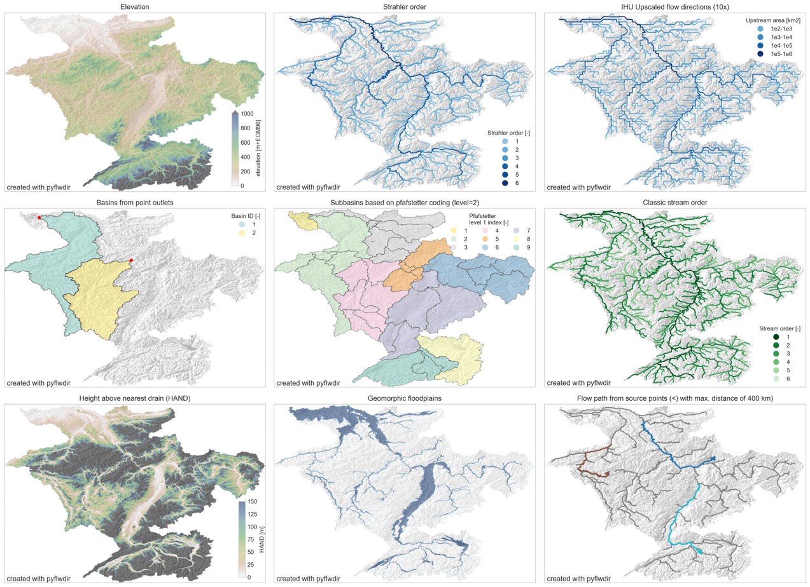

===========
EcoModel-VN
===========

Lightweight Environmental & Hydrological Modeling for Vietnam
-------------------------------------------------------------

**Status:** In Development — Private Repository

**Research pillar:** Engineering Models & Open AI

**Organization:** LEMBEM LAB (Laboratory for Emerging Media, Bio-informatics and Engineering Models), Vietnam

**Contact:** contact@lembem.com

Overview
========

**EcoModel-VN** is an early-stage scientific research initiative focused on
lightweight computational tools for hydrological analysis, river-basin
monitoring, water-quality research and flood-risk modeling in rural Vietnam.

The goal is to make reproducible methods, transparent modeling assumptions
and resource-efficient scientific workflows accessible to researchers,
universities and local communities.

**Current implementation:** This repository contains the original **PyFlwDir**
codebase from Deltares, used as the hydrological foundation of EcoModel-VN.
The code has **not yet** been refactored into a distinct EcoModel-VN Python
package. Water-quality simulation and end-to-end flood forecasting are
**planned research directions**, not already implemented capabilities.

Hydrological foundation
=======================

The existing PyFlwDir source code provides methods for:

* Flow directions from gridded Digital Elevation Models (DEMs)
* Upstream accumulation and river-network tracing
* Watershed and sub-basin delineation
* Stream orders and hydrological network analysis
* Height Above Nearest Drainage (HAND) terrain indices
* Flow-direction upscaling and related GIS workflows

These are useful terrain and hydrological-analysis building blocks, but
they should not be misrepresented as validated operational flood forecasts
or complete water-quality models.

Upstream project image
======================

The existing illustration below is retained from **Deltares / PyFlwDir**
as a reference to the technical foundation, not as an EcoModel-VN field result.

Research roadmap
================

**Phase 1 — Hydrological research baseline (current)**

* Review and reproduce PyFlwDir's terrain-processing capabilities.
* Develop example workflows for Vietnamese river basins and DEM datasets.
* Establish reproducible tests and document input-data requirements.

**Phase 2 — Environmental and water-quality data**

* Investigate integration of water-quality observations and IoT sensors.
* Develop input validation, provenance tracking and uncertainty reporting.
* Evaluate suitable open scientific models for rural water monitoring.

**Phase 3 — Flood-risk modeling**

* Study runoff, drainage and rainfall data integration.
* Evaluate lightweight flood-risk simulations and calibration strategies.
* Compare model outputs with observations before real-world deployment.

**Phase 4 — Public-benefit research deliverables**

* Prepare reusable examples, methodological notes and teaching resources.
* Review opportunities to publish additional components and datasets.

These phases are planned research activities, not completed features.

Codebase and local development
==============================

The upstream project structure and package name are preserved:

* **pyflwdir/** — current Python package, still imported as pyflwdir
* **examples/** — computational notebooks
* **tests/** — existing automated tests
* **docs/** — technical documentation and original image assets
* **pyproject.toml** — original Python build and tooling configuration
* **LICENSE** — original MIT licence and copyright notice

Requires **Python 3.11+**. For authorized collaborators, clone the private
repository and install the existing Python package:

.. code-block:: console

   git clone https://github.com/yanghoxom/ecomodel-vn.git
   cd ecomodel-vn
   python -m venv .venv
   # Activate the virtual environment for your OS
   python -m pip install -e ".[test]"
   python -m pytest tests -q

For existing APIs, consult the upstream PyFlwDir documentation:
https://deltares.github.io/pyflwdir/latest/

Licensing and source attribution
================================

EcoModel-VN is currently **private** and under active research development.
Private repository visibility does not override existing third-party licences.

The foundational source was created by **Deltares**, with contributors
including **Dirk Eilander** and **Willem van Verseveld**. The original
MIT licence and Deltares copyright statement are preserved in LICENSE.
Original image assets are retained in docs/_static/ for reference.

Further EcoModel-VN-specific implementations, publications and datasets
will be identified and licensed separately when available.

LEMBEM LAB: https://lab.lembem.com
Contact: contact@lembem.com
